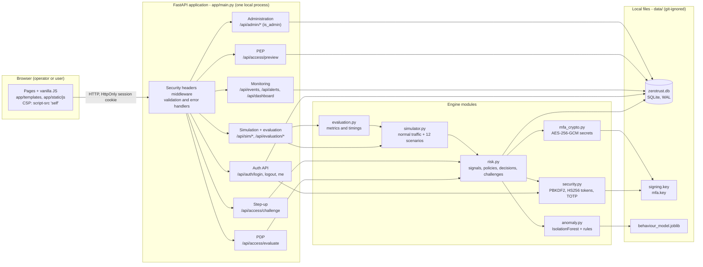
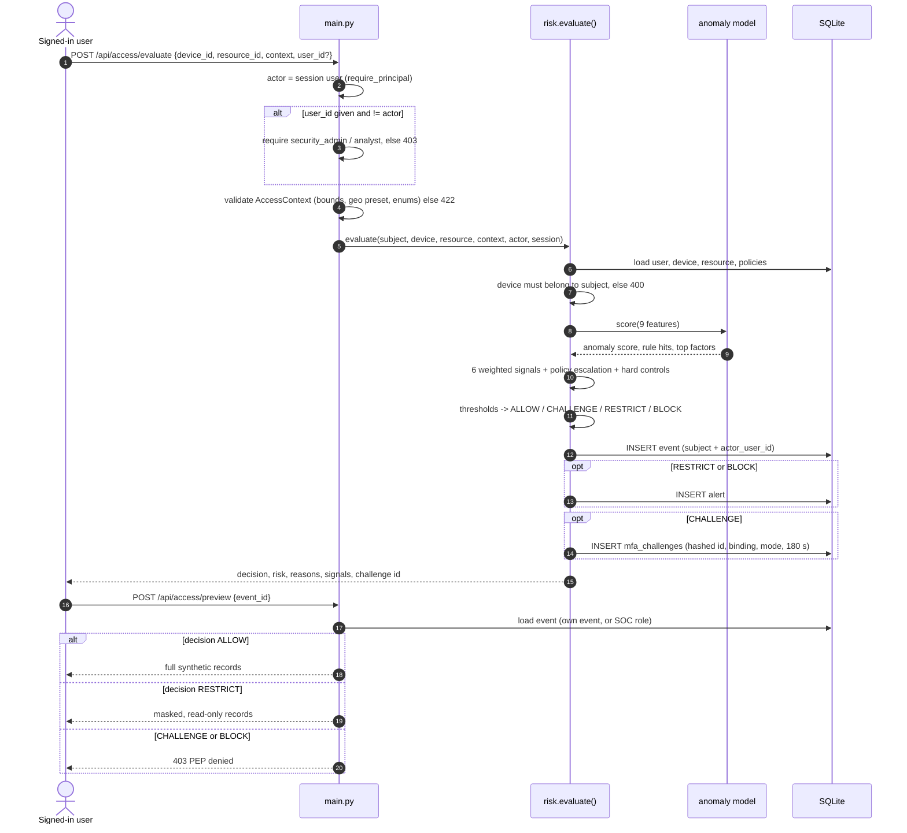
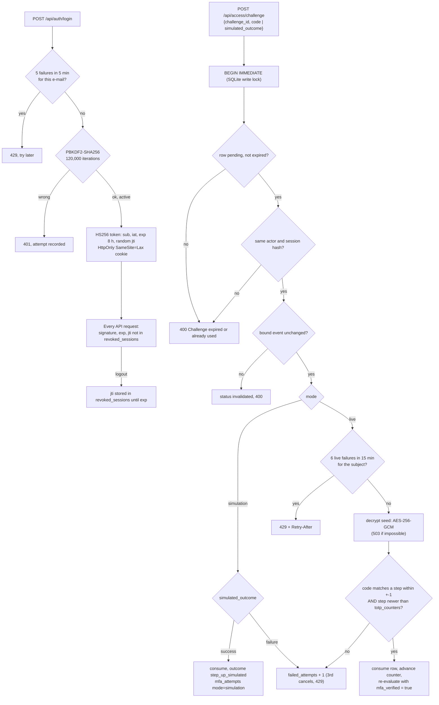
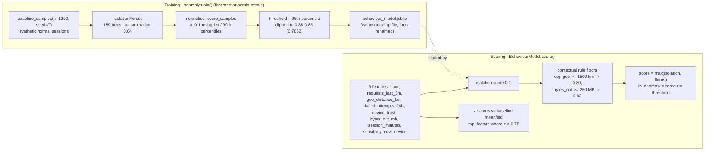
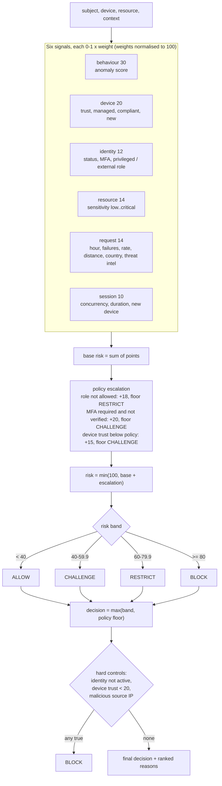
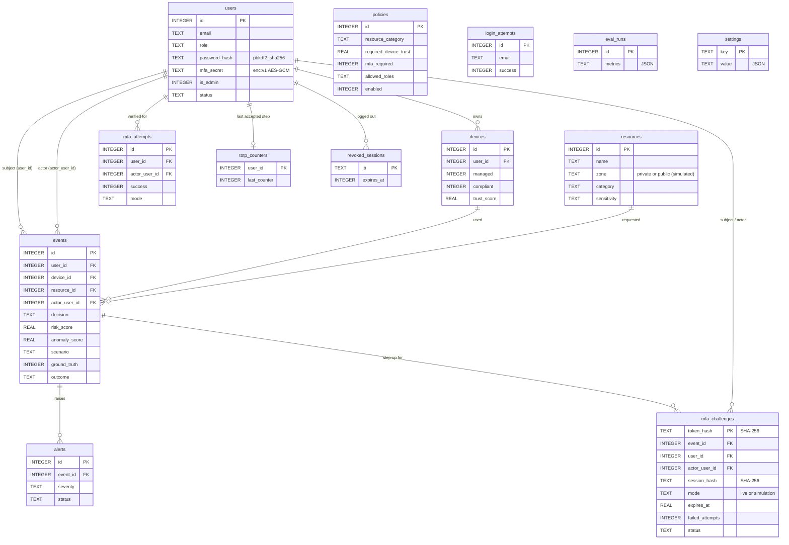

# Final architecture diagrams

Editable Mermaid diagrams drawn from the code in this repository (module and function names
are the real ones). GitHub renders them directly; they can also be pasted into
<https://mermaid.live> for export.

> **Everything here runs in one local Python process with one SQLite file.** The "private
> cloud" and "public cloud" are labels (`resources.zone`) on records in the local inventory.
> The IdP, PDP and PEP are logical roles played by modules of the same FastAPI application.
> There is no AWS, VPC, VPN, Kubernetes or network enforcement behind these diagrams.

## 1. Overall system architecture

## 2. Access request lifecycle

## 3. Identity and MFA verification

## 4. Isolation Forest workflow

## 5. Risk scoring and decisions

## 6. Database entity relationships

`policies` match resources by `resource_category` (not a foreign key); `login_attempts`,
`eval_runs` and `settings` stand alone.

## 7. Simulated hybrid-cloud trust zones

```mermaid
flowchart LR
    subgraph Subjects["Identities and devices (seeded records)"]
        U1["security_admin · analyst · developer<br/>finance · contractor · service"]
        D1["10 devices with trust 38-96,<br/>managed / unmanaged, compliant / not"]
    end

    subgraph Boundary["Zero-trust boundary - logical roles in one FastAPI process"]
        IDP["IdP role<br/>login, sessions, TOTP"]
        PDPZ["PDP role<br/>risk.evaluate()"]
        PEPZ["PEP role<br/>/api/access/preview<br/>returns synthetic records"]
    end

    subgraph Private["SIMULATED private data centre (zone = private)"]
        P1["identity-provider · high"]
        P2["finance-db · critical"]
        P3["hr-portal · high"]
        P4["internal-wiki · low"]
        P5["dev-vm-01 · medium"]
        P6["k8s-prod · critical"]
        P7["vpn-gateway · high"]
    end

    subgraph Public["SIMULATED public cloud (zone = public)"]
        Q1["public-web · low"]
        Q2["api-gateway · high"]
        Q3["analytics-lake · medium"]
        Q4["ml-training · medium"]
        Q5["backup-vault · critical"]
    end

    U1 --> IDP --> PDPZ --> PEPZ
    D1 --> PDPZ
    PEPZ -.->|"inventory record only,<br/>no network path"| Private
    PEPZ -.->|"inventory record only,<br/>no network path"| Public
```

The zone affects risk only through the resource's category and sensitivity and through the
policies that match it; no request ever leaves the local process.
