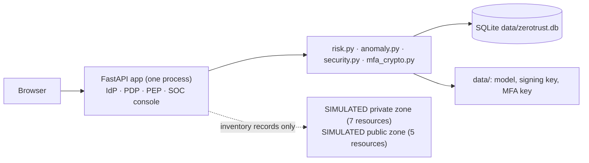

# Risk-Adaptive Zero-Trust Security Architecture for Hybrid Cloud Infrastructure

**Final project report**

| | |
| --- | --- |
| Team | Farhaan Pasha (R23EK009), Mayank Kaira, Shubham Kumar Pandey, Sudhanshu Bharadwaj, Syed Sulaiman |
| Faculty guide | Mr. Hidam Rameshwar Singh |
| Repository | <https://github.com/Pasha1234565/Risk-Adaptive-Zero-Trust-Security-Architecture-for-Hybrid-Cloud-Infrastructure> |
| Report date | 12 November 2026 |
| Artefact | Locally runnable research prototype (FastAPI, SQLite, scikit-learn) |

> This report describes a **research prototype**. The behavioural baseline is synthetic, attack
> traffic is simulated, the private and public cloud zones are records in a local SQLite
> inventory, real network or cloud packet enforcement is not implemented, and all performance
> figures are single-machine measurements. The system is not production-ready.

## 1. Abstract

Zero Trust replaces trust based on network location with continuous verification of identity,
device and context. Translating that principle into concrete access decisions that use
behaviour, and measuring the result, remains difficult, particularly for hybrid estates that span
a private data centre and a public cloud. This project builds and evaluates a risk-adaptive
zero-trust decision plane. A FastAPI application acts as identity provider, Policy Decision Point
(PDP) and Policy Enforcement Point (PEP). For each access request the PDP combines six weighted
signals (an Isolation Forest behavioural anomaly score over nine features, device posture,
identity assurance, resource sensitivity, request context and session context) with
organisational policies and hard controls into a 0–100 risk score, and returns Allow, Challenge
(step-up TOTP), Restrict (read-only) or Block with ranked explanations. The prototype includes
hardened session, MFA and identity controls, an attack simulator with twelve labelled
scenarios, monitoring and an evaluation module. On 140 synthetic normal sessions and 36
simulated attack requests the engine detected every attack (recall 1.0), contained 30 of 36
(Restrict or Block), and produced 13 false positives (precision 0.735, false-positive rate 9.3 %),
with an average decision latency of 13.6 ms on one machine. 439 automated tests pass.

## 2. Introduction

Enterprises increasingly run workloads in both an on-premises data centre and one or more public
clouds, accessed by employees, contractors and service accounts from managed and unmanaged
devices. A firewall perimeter cannot describe who should reach what in such an estate. The Zero
Trust model, described by NIST SP 800-207, treats every request as untrusted until the subject,
the device and the context have been evaluated, and grants the least privilege needed.

Static rules decide well when the context is clean or obviously hostile. Most interesting cases
lie between: a valid password used at an unusual hour from another country, or a legitimate
user moving far more data than usual. This project explores *risk-adaptive* access control: the
response is proportional to the measured risk, from silent Allow, through step-up
authentication, to read-only access or denial.

## 3. Background

- **Zero Trust Architecture (NIST SP 800-207).** Resources, not network segments, are protected.
  Authentication and authorisation of subject and device are discrete functions performed before
  a session is established. A policy engine/decision point decides and a policy enforcement point
  enforces.
- **Identity and access management.** Passwords stored as salted slow hashes (PBKDF2), signed
  session tokens, roles and least-privilege policies, and step-up multi-factor authentication
  with time-based one-time passwords (TOTP, RFC 6238, built on HOTP, RFC 4226).
- **Behavioural anomaly detection.** Baselines of normal behaviour and scores that measure
  deviation. Isolation Forest (Liu, Ting and Zhou, 2008) isolates observations with random
  splits; anomalies need fewer splits and receive higher scores. It is unsupervised, which suits
  settings where labelled attacks are scarce.
- **Risk-based access control.** Combining multiple contextual signals into a risk level and
  mapping it to graded responses, including step-up authentication.
- **MITRE ATT&CK.** A public knowledge base of adversary techniques, used here to label the
  simulated scenarios (for example T1078 Valid Accounts, T1110 Brute Force, T1567 Exfiltration
  Over Web Service).

## 4. Problem statement

Zero Trust guidance defines principles but not how behavioural risk should change an access
decision in a specific hybrid-cloud setting. Behavioural analytics often stop at alerts, and
access-control systems often ignore behaviour. The team's literature survey found little evidence
of an integrated, *evaluated* prototype that (a) models private and public cloud resources and
their boundary, (b) scores behaviour continuously from access and authentication data, and (c)
maps the combined risk to Allow, Challenge, Restrict or Block, while measuring detection quality
and the cost in latency and authentication overhead.

## 5. Project objectives

1. Model a hybrid estate (private data centre and public cloud resources, identities, devices,
   policies) and document its trust boundary.
2. Authenticate users and devices and verify every request regardless of origin.
3. Learn a baseline of normal behaviour and compute an explainable anomaly score.
4. Combine identity, device, behaviour, resource, request and session context into a risk score
   and an adaptive decision with least privilege.
5. Provide monitoring, alerting and audit attribution.
6. Generate controlled normal and attack traffic and evaluate detection accuracy, false-positive
   and false-negative rates, decision latency, authentication overhead, service latency and
   availability.
7. Keep the system reproducible and runnable on one laptop without cloud accounts.

## 6. Literature survey summary

The team's survey (`Literature_and_survey.md`) used NIST SP 800-207 as the verified conceptual
anchor and grouped related work into themes: Zero Trust research and practice, hybrid-cloud
security and trust boundaries, risk-adaptive and context-aware access control, behavioural
anomaly detection and UEBA, machine learning for security anomaly detection, and security
monitoring and evaluation. Its comparative analysis concluded that existing approaches are strong
on principles or on detection in isolation, but rarely connect behavioural scores to graded access
decisions in a measured hybrid-cloud prototype; that is the gap this project addresses. The survey
itself marks most specific academic papers as *candidate sources still to be verified*; this
report therefore cites only standards and well-established primary references (section 23).

## 7. Proposed system

A single-host decision plane with three logical roles:

- **Identity provider:** password login with throttling, signed sessions with server-side
  revocation, TOTP step-up with attempt limits and replay protection, encrypted TOTP secrets.
- **Policy Decision Point:** the risk engine (`app/risk.py`) and behavioural model
  (`app/anomaly.py`) producing a decision with reasons for every request.
- **Policy Enforcement Point:** `/api/access/preview`, which releases synthetic resource records
  only according to the stored decision (full for Allow, masked read-only for Restrict, none
  otherwise).

Around them sit a security operations console (dashboard, monitoring, alert triage), an attack
simulation lab, an evaluation module and an administration console for policies, thresholds and
model retraining.

## 8. System architecture

The complete diagrams are in [`FINAL_ARCHITECTURE_DIAGRAMS.md`](FINAL_ARCHITECTURE_DIAGRAMS.md)
(system, request lifecycle, identity and MFA, Isolation Forest, risk scoring, entity
relationships, simulated trust zones) and the design notes in
[`ARCHITECTURE.md`](ARCHITECTURE.md).

The private zone holds the identity provider, finance database, HR portal, internal wiki,
developer VM, production Kubernetes and VPN gateway; the public zone holds the public web tier,
API gateway, analytics lake, ML training and backup vault. These are rows in the `resources`
table with a zone, service, category, sensitivity and owner; no infrastructure exists behind
them.

## 9. Technology stack

| Layer | Technology (verified versions) |
| --- | --- |
| Language | Python 3.13.5 |
| Web framework | FastAPI 0.162.2 on Starlette 1.10.0, Uvicorn 0.46.0, Pydantic 2.14.3 |
| Templates and UI | Jinja2 3.1.6, vanilla JavaScript and CSS, Swagger UI 5.34.1 served locally |
| Machine learning | scikit-learn 1.8.0 (IsolationForest), NumPy 2.4.4, SciPy 1.18.1, joblib 1.5.3 |
| Cryptography | Python `hashlib`/`hmac` (PBKDF2, HMAC-SHA256, HMAC-SHA1 for TOTP), `cryptography` 50.0.2 (AES-256-GCM) |
| Persistence | SQLite 3.49.1 via the standard `sqlite3` module, WAL mode |
| Testing | pytest 8.4.2, httpx 0.28.1 (FastAPI TestClient) |
| Reproducibility | `requirements*.txt` plus `constraints.txt` pinning all 33 packages |

## 10. Implementation details

| Module | Responsibility |
| --- | --- |
| `app/main.py` | routes, session handling, role checks, validation and error handlers, security headers |
| `app/security.py` | PBKDF2 hashing, HS256 tokens with `jti`, revocation, TOTP and replay-safe consumption |
| `app/mfa_crypto.py`, `app/keystore.py` | AES-256-GCM secret encryption, key loading, start-up migration, atomic key files |
| `app/risk.py` | signal computation, policy escalation, hard controls, decisions, persisted challenges |
| `app/anomaly.py` | synthetic baseline, Isolation Forest training, scoring, rule floors, attribution |
| `app/database.py` | schema, additive migrations, WAL connection handling, helper queries |
| `app/seed.py` | demo identities, devices, resources and policies |
| `app/simulator.py` | normal traffic generator and twelve attack scenarios |
| `app/evaluation.py` | labelled evaluation, metrics, timings, stored runs |

The code base is about 4,000 lines of Python in `app/`, plus templates, JavaScript and 439 tests.
Development after the initial prototype proceeded in phases recorded in the Git history: Phase 2
(test isolation, anomaly-rule correction, session revocation, demo-helper restriction, browser
and API-docs fixes, dependency reproducibility), Phase 2.1 (MFA attempt limits, TOTP replay
protection, authenticated identity enforcement, challenge binding, audit attribution), Phase 2.2
(encrypted TOTP secrets, role-based visibility, persistent challenges, separation of simulated
MFA, input validation, multi-worker safety) and a final validation phase.

## 11. Identity and access management

- **Passwords:** PBKDF2-HMAC-SHA256, 120,000 iterations, 16-byte random salt, constant-time
  comparison. Five failures within five minutes temporarily lock an e-mail address.
- **Sessions:** HS256-signed tokens with `sub`, `iat`, `exp` (8 hours) and a random `jti`,
  delivered as an HttpOnly, SameSite=Lax cookie (or a Bearer header). Logout stores the `jti` in
  `revoked_sessions` until the token expires, and every request checks it.
- **Roles:** `security_admin`, `analyst`, `developer`, `finance`, `contractor`, `service`.
  Administration APIs require `is_admin`. Only security administrators and analysts may evaluate
  another identity or run simulations; the acting user is always the session user and is stored
  as `events.actor_user_id`.
- **Least privilege:** eleven policies match resource categories, each with a required device
  trust, an MFA requirement and an optional list of allowed roles.
- **Visibility:** SOC roles see all identities, devices, events and alerts; other roles see only
  their own identity, devices and events and only resources their role is permitted to use.
  Another identity's event is answered with 404, and only SOC roles may acknowledge alerts.
- **Step-up MFA:** challenges live in the `mfa_challenges` table (SHA-256 of the id, bound to
  subject, actor, hashed session, device, resource and event, 180-second lifetime). Three wrong
  codes cancel a challenge; six wrong live codes per identity in 15 minutes pause verification.
  Each 30-second TOTP step is accepted once per user. All checks and updates run in one SQLite
  `BEGIN IMMEDIATE` transaction, so they hold across threads and worker processes.
- **Secrets:** TOTP seeds are stored as AES-256-GCM ciphertext bound to the user id; the key is
  kept outside the database (`ZT_MFA_ENCRYPTION_KEY` or `data/mfa.key`).
- **Simulations:** a challenge produced when an operator acts for someone else, or by the
  simulator, is a *simulation* challenge answered only with a simulated outcome; it never
  touches the subject's real TOTP state or throttle.

## 12. Behavioural anomaly detection

- **Features (9):** login hour, requests in the last 5 minutes, distance from the home location
  (km), failed logins in 24 hours, device trust score, egress volume (MB), session duration
  (minutes), resource sensitivity (1–4) and a new-device flag.
- **Baseline:** `baseline_samples(1200, seed=7)` draws synthetic normal sessions (office hours
  with 12 % early shifts, 16 % travel to a second office, 20 % lower-trust devices, 3 % new
  devices).
- **Model:** scikit-learn `IsolationForest` with 180 trees and contamination 0.04. Raw scores are
  normalised to 0–1 between the 1st and 99th percentiles of the training scores. The anomaly
  threshold is the 95th percentile of the normalised training scores, clipped to 0.35–0.85
  (0.7862 with the default seed). The model is saved to `data/behaviour_model.joblib`.
- **Contextual rules:** seven rules can raise the score to a floor, for example geo distance ≥
  1,500 km → 0.80, ≥ 3,000 km → 0.92, failed logins ≥ 6 → 0.78, requests ≥ 40 per 5 minutes →
  0.74, egress ≥ 250 MB → 0.82. Rules are parsed with a strict grammar, never evaluated as code.
- **Explanation:** each feature's z-score against the baseline mean and standard deviation; the
  largest positive deviations (z > 0.75) are reported as "Baseline deviation" reasons.

## 13. Risk scoring methodology

Each of six factors is a value in [0, 1]:

| Signal | Weight | Factor inputs |
| --- | --- | --- |
| Behaviour | 30 | anomaly score |
| Device | 20 | (1 − trust/100) × 0.75, + 0.15 each for unmanaged, non-compliant, new device |
| Identity | 12 | inactive +0.50; MFA enrolled but not verified +0.45 (or no MFA +0.22); privileged role +0.15; contractor or service +0.18 |
| Resource | 14 | sensitivity: low 0.15, medium 0.40, high 0.70, critical 1.00 |
| Request | 14 | off-hours, failed logins, request rate, distance, foreign country, threat intelligence |
| Session | 10 | concurrent sessions, long sessions, new device |

Weights are normalised to sum to 100, so base risk = Σ factor × weight ∈ [0, 100]. Policies add
**escalation**: +18 and a minimum of Restrict when the role is not allowed for the category; +20
and a minimum of Challenge when MFA is required but not verified; +15 and a minimum of Challenge
when device trust is below the policy requirement. Risk = min(100, base + escalation).

## 14. Adaptive access decisions

| Risk | Decision | Enforcement by the PEP |
| --- | --- | --- |
| < 40 | Allow | full synthetic records |
| 40 – < 60 | Challenge | nothing until step-up MFA succeeds and the request is re-evaluated |
| 60 – < 80 | Restrict | read-only, sensitive fields masked; an alert is raised |
| ≥ 80 | Block | denied; an alert is raised |

The final decision is the stricter of the risk band and any policy minimum. **Hard controls**
force Block for a non-active identity, device trust below 20 or a malicious source IP. Every
decision carries per-signal points, matched policies, anomaly attribution and ranked reasons.
Thresholds are stored in the database and editable by administrators.

## 15. Database design

SQLite tables: `users`, `devices`, `resources`, `policies`, `events`, `alerts`, `eval_runs`,
`settings`, `login_attempts`, `revoked_sessions`, `totp_counters`, `mfa_attempts` and
`mfa_challenges` (entity-relationship diagram in `FINAL_ARCHITECTURE_DIAGRAMS.md`, section 6).
Design points:

- `events` stores the full decision (signals, reasons, context as JSON), the subject
  (`user_id`), the actor (`actor_user_id`), the scenario, ground truth and outcome, so history can
  be explained without re-running the engine.
- No table stores a TOTP code, a plaintext seed or a raw challenge or session id; challenges and
  sessions are referenced by hashes, revocations by `jti`.
- Schema changes are additive and applied at start-up; plaintext secrets from older versions are
  encrypted in one transaction; repeated starts change nothing.
- Connections use WAL mode and foreign keys; start-up is safe when several worker processes open
  a new database at the same time.

## 16. Attack simulation methodology

`app/simulator.py` defines twelve scenarios, each a fixed subject, device, resource and context
labelled with a MITRE ATT&CK technique: Impossible Travel, Credential Stuffing, Distributed Brute
Force, Compromised Developer Endpoint, Insider Data Exfiltration, Privilege Escalation, MFA
Fatigue, Rogue Service Account, Off-Hours Access Drift, Unmanaged Contractor Device, Lateral
Movement, and API Abuse / Key Misuse. Each run creates 1–5 variants; variants after the first scale
request rate, failed logins and egress by seeded random factors. Normal traffic picks an
interactive identity, a resource from role-appropriate categories, a device that meets the policy
trust requirement and a business-hours context, from a seeded generator.

The simulations only change the request context passed to the engine. No packets are sent, no
external host is contacted and no real credentials are attacked. Only security administrators
and analysts can run them, every resulting event records the operator, and simulation events
are labelled `simulated`.

## 17. Testing and validation

| Evidence | Result |
| --- | --- |
| Automated tests (`python -m pytest -q`, 23 test files) | 439 passed (also with plain `pytest -q`) |
| Fresh virtual environment from `constraints.txt` | installed set equals the file (33 packages), `pip check` clean |
| Functional audit (`scripts/final_audit.py`) | 52 checks passed, 0 failed (`docs/evidence/functional_audit.md`) |
| Browser verification (`scripts/final_screenshots.py`) | 15 checks passed, 17 screenshots, no page errors or CSP violations |
| Every development commit run in an isolated clone | all pass |

The suite covers the decision engine and anomaly rules, API behaviour, session revocation, demo
helper restrictions, MFA attempt limits, TOTP replay including concurrency, identity
enforcement, challenge ownership and persistence (including two separate Uvicorn processes
sharing one database), MFA secret encryption and migration, role-based visibility, simulated
MFA, malformed input across every API route, concurrent start-up, repository hygiene and
frontend asset wiring.

During final validation a repeated full test run exposed an intermittent start-up failure
(1 in 8 runs): a worker could exit with "database is locked" while switching a brand-new
database to WAL mode at the same time as another worker. It was reproduced (6 failures in 60
concurrent process starts), fixed by retrying the switch, covered by new tests, and the suite then
passed 8 consecutive full runs.

## 18. Experimental results

Full details: [`FINAL_EVALUATION.md`](FINAL_EVALUATION.md). Configuration: 140 normal sessions
(seed 2026), 12 scenarios × 3 variants, default thresholds, weights and model; measured
2026-11-12 on Windows 11, Python 3.13.5; identical detection results in three runs.

| Metric | Risk engine | Anomaly detector alone |
| --- | --- | --- |
| Confusion matrix (TP / FP / TN / FN) | 36 / 13 / 127 / 0 | 36 / 15 / 125 / 0 |
| Accuracy | 0.9261 | 0.9148 |
| Precision | 0.7347 | 0.7059 |
| Recall | 1.0000 | 1.0000 |
| F1 | 0.8471 | 0.8276 |
| False-positive rate | 0.0929 | 0.1071 |
| False-negative rate | 0.0000 | 0.0000 |

- **Containment:** 30 of 36 attack requests ended in Restrict or Block. Insider Data
  Exfiltration (risk 57.8) and Off-Hours Access Drift (48.7–49.3) were only challenged.
- **False positives:** four Restrict decisions for analysts requesting `k8s-prod` (the traffic
  generator lets analysts use orchestration, the policy does not) and nine Challenges with risk
  40.4–47.5 from the upper tail of normal behaviour.
- **Performance:** decision latency average 13.57 ms, p50 13.52 ms, p95 13.92 ms, maximum
  15.93 ms; PBKDF2 authentication overhead 48.4 ms per login; protected-service read 1.52 ms;
  availability 176/176.

## 19. Security analysis

| Threat | Control | Verified by |
| --- | --- | --- |
| Stolen or replayed session token after logout | `jti` revocation checked on every request | `test_sessions.py`, functional audit |
| Password guessing | PBKDF2, 5-failure lock per e-mail | audit, `test_api.py` |
| MFA code guessing | 3 attempts per challenge, 6 per identity per 15 min | `test_mfa_attempts.py` |
| TOTP replay within its window | per-user accepted-step counter, atomic | `test_totp_replay.py` |
| Answering someone else's challenge | binding to actor and session hash; generic error | `test_challenge_ownership.py` |
| Spoofing another identity in the request body | subject defaults to session user; others need a SOC role | `test_identity_enforcement.py` |
| Operator locking out a real user via simulations | simulation challenges use simulated outcomes only | `test_simulated_mfa.py` |
| Copied database exposing TOTP seeds | AES-256-GCM with key outside the database | `test_mfa_encryption.py` |
| Directory and activity enumeration | role-scoped inventory, events, alerts, dashboard | `test_inventory_visibility.py` |
| Malformed input causing 500s or leaking internals | Pydantic validation, sanitised 422 and 500 bodies | `test_malformed_input.py` |
| Script injection, clickjacking | strict CSP (`script-src 'self'`), `X-Frame-Options: DENY`, no inline scripts | `test_api_docs.py`, browser checks |
| Lost or inconsistent state with several workers | SQLite-backed state, atomic start-up, WAL retry | `test_challenge_persistence.py`, `test_concurrent_startup.py` |

Repository hygiene: `data/` (database, backups, model, signing key, MFA key), `.venv` and
environment files are git-ignored; a final scan found no tracked database, model, key, secret,
live TOTP seed or credential (the demo passwords are intentionally public and shown on the login
page).

Residual risks on the development machine: three database backups made before encryption still
contain the current TOTP seeds in plaintext (git-ignored, outside the repository's history), and
the MFA key file sits next to the database. Both are documented with a cleanup plan.

## 20. Limitations

- Behavioural baseline, normal traffic and attacks are synthetic and seeded; the model is
  evaluated on data generated under the same assumptions it was trained on.
- Twelve fixed attack patterns with small variations; no adaptive adversary.
- Private and public cloud zones are inventory records; there is no network, VPC, VPN or
  service mesh, and the PEP returns synthetic records rather than controlling real traffic.
- SQLite on one host; several workers are supported only on one machine; an admin model retrain
  updates only the worker that handled it.
- TOTP is the only second factor; a loopback-only demo helper exists for demonstrations.
- The MFA encryption key is a local file or environment variable, not a KMS or HSM; no key
  rotation command.
- No TLS, `Secure` cookie flag or HSTS by default (local HTTP).
- Timings are single-process, single-machine measurements without network or IdP costs.
- Two attack scenarios are detected but only challenged; precision is limited by a
  generator/policy mismatch and by normal sessions just above the Allow threshold.

## 21. Future enhancements

- Enforce decisions in a real path (API gateway, reverse proxy or service mesh) between actual
  private and public environments.
- Use an external IdP with WebAuthn/passkeys and device attestation.
- Store keys in a KMS or HSM and add key rotation.
- Train and evaluate on real, privacy-reviewed telemetry; per-user baselines; drift monitoring.
- Calibrate weights and thresholds on a held-out set and report ROC curves.
- Add scenarios where the insider holds valid MFA, and stronger responses for high-egress
  sessions.
- Move to a database server and stateless PDP instances; forward events to a SIEM.

## 22. Conclusion

The project delivers a working, tested and documented risk-adaptive zero-trust decision plane for
a simulated hybrid-cloud estate. It verifies every request, turns behaviour into an explainable
anomaly score, combines it with identity, device, resource, request and session context and
policy, and responds proportionally. The supporting identity controls were hardened against
session replay, MFA guessing and replay, identity spoofing, operator misuse of simulations and
database disclosure, and each control is covered by automated tests. On the synthetic evaluation
every attack was detected and 83 % were contained, at about 13.6 ms per decision; the remaining
gaps (insider scenarios that end in Challenge, false positives from generator/policy mismatch)
are measured and explained rather than hidden. The results demonstrate the design on synthetic
data; they do not establish production performance.

## 23. References

1. S. Rose, O. Borchert, S. Mitchell and S. Connelly, *Zero Trust Architecture*, NIST Special
   Publication 800-207, National Institute of Standards and Technology, 2020.
   <https://doi.org/10.6028/NIST.SP.800-207>
2. F. T. Liu, K. M. Ting and Z.-H. Zhou, "Isolation Forest", *Proceedings of the 8th IEEE
   International Conference on Data Mining (ICDM)*, 2008, pp. 413–422.
3. D. M'Raihi, S. Machani, M. Pei and J. Rydell, *TOTP: Time-Based One-Time Password Algorithm*,
   RFC 6238, IETF, 2011.
4. D. M'Raihi, M. Bellare, F. Hoornaert, D. Naccache and O. Ranen, *HOTP: An HMAC-Based One-Time
   Password Algorithm*, RFC 4226, IETF, 2005.
5. K. Moriarty, B. Kaliski and A. Rusch, *PKCS #5: Password-Based Cryptography Specification
   Version 2.1*, RFC 8018, IETF, 2017 (PBKDF2).
6. M. Dworkin, *Recommendation for Block Cipher Modes of Operation: Galois/Counter Mode (GCM) and
   GMAC*, NIST Special Publication 800-38D, 2007.
7. M. Jones, J. Bradley and N. Sakimura, *JSON Web Token (JWT)*, RFC 7519, IETF, 2015.
8. MITRE ATT&CK knowledge base, <https://attack.mitre.org/>.
9. F. Pedregosa et al., "Scikit-learn: Machine Learning in Python", *Journal of Machine Learning
   Research*, 12, 2011, pp. 2825–2830.
10. Project literature survey and requirement analysis, `Literature_and_survey.md` (this
    repository); candidate sources listed there are marked by the survey as not yet verified.
